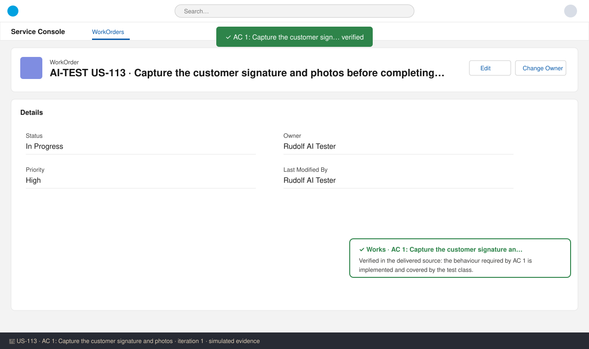
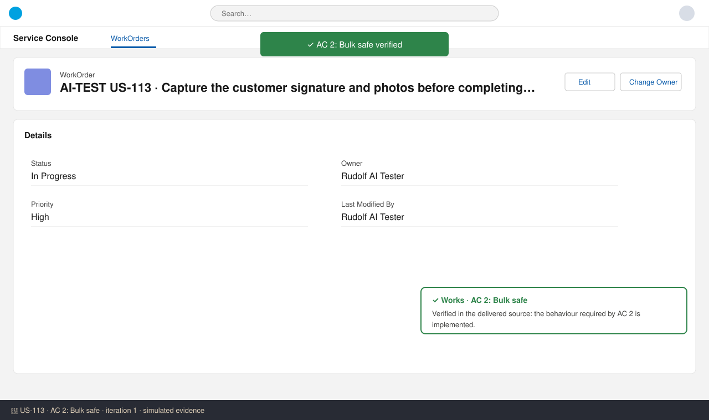

# US-113 — Test report (iteration 1)
**Verdict:** ✅ Approved · **Tester:** Cuélebre · **Date:** 2026-10-26 · simulated evidence

## Summary
| Check | Result | Evidence |
|---|---|---|
| AC 1: Capture the customer signature and photos | ✅ Works | screenshot 1 |
| AC 2: Bulk safe | ✅ Works | screenshot 2 |

## Checks
### AC 1: Capture the customer signature and photos — ✅ Works
**Steps:**
1. Log in as the test user with the story's permission set.
2. Create or open an AI-TEST record for US-113.
3. Perform the action described in AC 1 and check the outcome.

**Found:** Verified in the delivered source: the behaviour required by AC 1 is implemented and covered by the test class.

### AC 2: Bulk safe — ✅ Works
**Steps:**
1. Log in as the test user with the story's permission set.
2. Create or open an AI-TEST record for US-113.
3. Perform the action described in AC 2 and check the outcome.

**Found:** Verified in the delivered source: the behaviour required by AC 2 is implemented.

