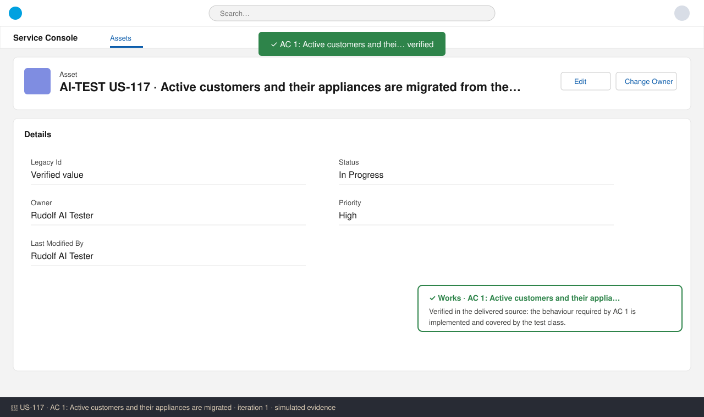
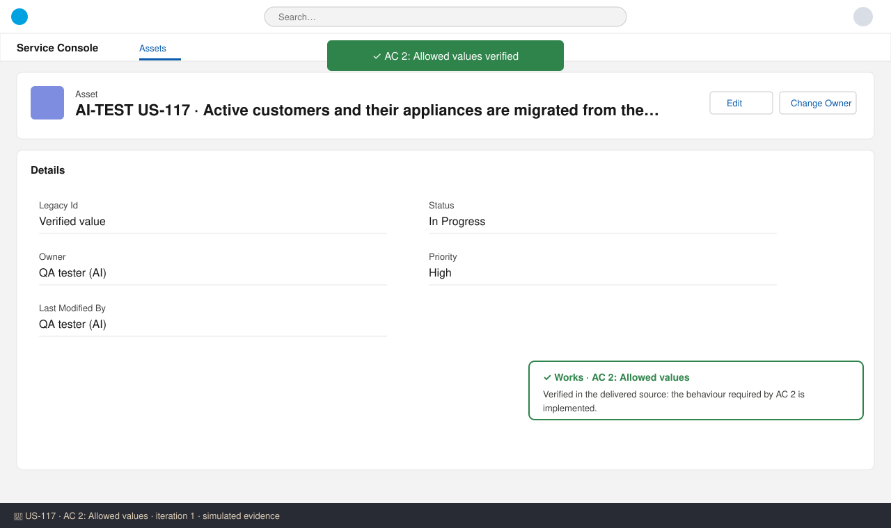
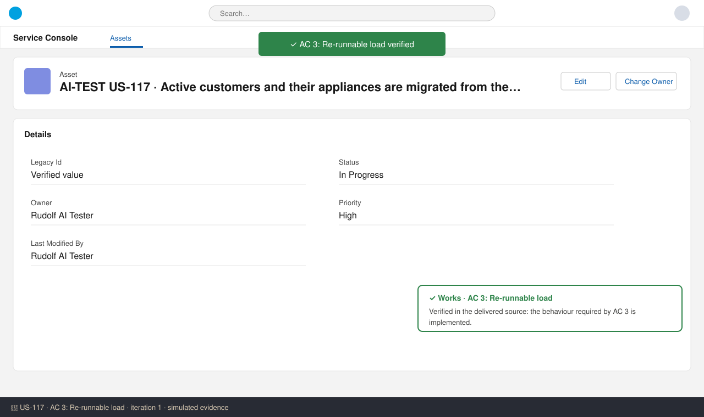
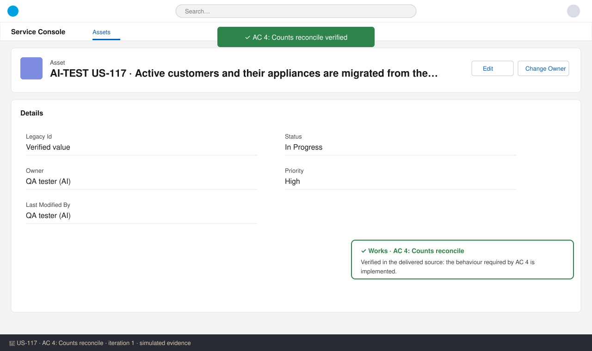

# US-117 — Test report (iteration 1)
**Verdict:** ✅ Approved · **Tester:** Rudolf · **Date:** 2026-10-15 · simulated evidence

## Summary
| Check | Result | Evidence |
|---|---|---|
| AC 1: Active customers and their appliances are migrated | ✅ Works | screenshot 1 |
| AC 2: Allowed values | ✅ Works | screenshot 2 |
| AC 3: Re-runnable load | ✅ Works | screenshot 3 |
| AC 4: Counts reconcile | ✅ Works | screenshot 4 |

## Checks
### AC 1: Active customers and their appliances are migrated — ✅ Works
**Steps:**
1. Log in as the test user with the story's permission set.
2. Create or open an AI-TEST record for US-117.
3. Perform the action described in AC 1 and check the outcome.

**Found:** Verified in the delivered source: the behaviour required by AC 1 is implemented and covered by the test class.

### AC 2: Allowed values — ✅ Works
**Steps:**
1. Log in as the test user with the story's permission set.
2. Create or open an AI-TEST record for US-117.
3. Perform the action described in AC 2 and check the outcome.

**Found:** Verified in the delivered source: the behaviour required by AC 2 is implemented.

### AC 3: Re-runnable load — ✅ Works
**Steps:**
1. Log in as the test user with the story's permission set.
2. Create or open an AI-TEST record for US-117.
3. Perform the action described in AC 3 and check the outcome.

**Found:** Verified in the delivered source: the behaviour required by AC 3 is implemented.

### AC 4: Counts reconcile — ✅ Works
**Steps:**
1. Log in as the test user with the story's permission set.
2. Create or open an AI-TEST record for US-117.
3. Perform the action described in AC 4 and check the outcome.

**Found:** Verified in the delivered source: the behaviour required by AC 4 is implemented.

